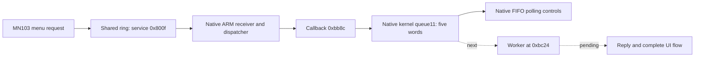

# GM5 ARM firmware extension

The emulator now has a separate bounded ARM/Thumb backend. The original NOR
backup contains native ARM vectors, Thumb-2 code, references to the same shared
ring as the stopped MN103 application, and a service dispatcher that accepts
destination 2. Native receiver, callback and kernel-queue transport now run.
Complete ARM boot and the worker/reply path remain incomplete.

## Exact source and execution contract

The ARM input is the `0x340000`-byte slice at original NOR offset `0x1760000`.
Its SHA-256 is
`3538e32f5310a89e48a2534f4cb4737fda679b8683a635bea31ab557cf762d3c`.
Extraction requires the complete original backup hash
`c51dca467a8bd24c0be75915acb54692f9213a7d7b9896c5e50a010d830a35ca`.
The private extracted image is read-only. This is an existing backup slice,
not a new physical camera read.

The installed-backup ARM slice differs from the official decoded ARM component
at one byte: offset `0x2f2f6c`, installed `0x11`, official `0x10`. The extension
uses the backup bytes. It does not rewrite either source.

`tools/gm5_arm_emulator.py` uses Unicorn 2.1.4 and a hash-pinned Capstone 5.0.9
distribution in a separate virtual environment. That Capstone distribution's
Python binding reports version 5.0.7; each execution records both identifiers
and hashes the actual native libraries and binding entry files. The pinned
wheels, rather than the binding's version string alone, define the dependency.

The Cortex-A9 model is an explicit Thumb-2-capable fixture, not identification
of the camera's ARM silicon. Code starts at image address zero as indicated by
the reset-vector literals. Function probes supply their own ordinary caller
scratch memory, SP/LR and instruction-set state. Unknown device accesses fault;
unreviewed system-control operations stop before execution. No interrupt or reply is
fabricated. The previous MN103 binaries, receipts and region candidate remain
unchanged.

The first probe exposed a harness ordering error: changing from the emulator's
initial CPU mode after setting SP/LR selected another register bank. CPU mode
is now selected before those registers are written. A native return test checks
the caller's bank, SP/LR and continuous/step agreement.

## Native communication counterpart

The ARM image contains literals for `0x93f01110`, `0x93f01810`, `0x93f01000` and
`0x9c013006`. Its leaf decoders at `0x23d22` and `0x23fb8` mask the same high
service-ID bits as MN103 `0x7bc152e5`. The ARM validator at `0x23e3c` has the
same three service-ID ranges as MN103 `0x7bc15308`:

| Destination | Valid service IDs |
| --- | --- |
| 0 | `0x0001..0x001e` |
| 1 | `0x4001..0x400b` |
| 2 | `0x8001..0x8016` |

ARM registration `0x23e82` and dispatch `0x23f6e` explicitly require destination
2. The dispatcher looks up a native callback table and calls the selected entry.
Its native initialization and the `0x800f` callback are traced below. A complete
cross-processor request/reply test remains work in progress.

`gm5_arm_controls.py` compares both processors' actual decoder and validator
returns for 18 IDs covering range boundaries, the queued service and invalid
destinations. It also retains the actual reset-vector branch and the first
unmodeled CP15 instruction. Results are recorded in a new output directory.
All 38 controls pass. The [verified extension evidence](../evidence/gm5-cooperative-arm-extension.json)
also records 105 passing repository tests, without skips.

## Native receiver and actual callback

`work/gm5-arm-native-ipc-1` passes eight additional bounded stages using the
MN103 **emulation** snapshot, not a physical camera RAM capture:

- The actual registration site `0xbc82` computes service `0x800f` and Thumb
  callback `0xbb8d`.
- Native prefix `0x6038..0x604c` establishes the ARM service context at
  `0x363480`, its list head and callback table. Its ordinary backing page starts
  zero as an explicit fixture; the prefix stops before controller setup.
- Low-level native registration stores that callback and sets the shared mask,
  then stops before its notification-register store. The outer kernel locking
  wrapper is not claimed to have executed.
- Two direct native receiver polls at `0x23c20` read both actual ring messages,
  advance the head from 0→12→24 and create the native linked message objects.
  Each poll stops before its first local interrupt-controller operation.
- Native dispatch `0x23f6e` selects the real callback. For both command 4 and
  command 0, the callback reaches ARM-mode `0x1d3c04` with ID11 and pointers
  `0x2027c17c` / `0x2027c02c`. The native conversion replaces the incoming
  pointer's upper nibble with `0x2`; the serial fixture maps this view to the
  retained MN103 `0x70` RAM bytes.

In that earlier experiment, no fixture writes a message header, payload, ring
head or ring tail. No interrupt, kernel queue post or acknowledgement is supplied. These are direct function
probes with fresh caller frames at each stage. They establish the receiver and
callback's actual data handling; the ARM kernel queue/worker/reply path still
needs initialization and execution. The calls at `0x1d3c04` and receiving
`0x1f119c` are being traced as the mailbox interface; no full UI success is claimed.

## Native kernel initialization and queue transport

The [runtime evidence](../evidence/gm5-native-arm-runtime.json) advances this
boundary through the real kernel queue. All **111 repository tests** pass
(124.593 seconds, no skips). The earlier 105-test and eight-stage receiver
milestones retain their own sources and receipts.

Native `0x20c` copies its ROM-selected text, read-only data and initialized-data
intervals from the ARM slice at NOR `0x41760000`. It clears BSS
`0x340000..0x3fc22c` itself. The harness first fills the containing ordinary RAM
with `0xa5`; a complete byte comparison verifies the exact 770,604-byte clear,
unchanged source/image bytes and untouched page suffix. This executes 439,536
instructions, without replacing a startup instruction.

The kernel initializes FIQ and IRQ stack banks, returning in Supervisor mode.
The first System-mode caller used the wrong bank and returned through an unset
Supervisor LR. After correcting that caller, the next boundary was NEON `vpush`
in the native memory-clear helper. The backend now serializes supported banked
registers, SPSRs, FPEXC/FPSCR and D0–D31. Three tests verify bank transitions,
complete snapshot restoration, native 127/128-byte NEON clears with unchanged
padding/callee registers, and invalid-state/profile refusals.

Only the pinned boot instructions for FP access, ISB and FPEXC setup at
`0x318..0x338` are permitted as an optional system-instruction profile. The
eight-instruction sequence establishes FPEXC `0x40000000`. In this Cortex-A9
fixture, CPACR reads back zero after the native write of `0x00f00000`; its
privilege behavior is not a hardware prediction. Other CP15/cache/MMU operations
still stop. Native NEON execution and register preservation have separate
controls from that unresolved CPACR behavior.

With that state retained, the native kernel prefix executes 495 instructions
and reaches its application constructor. Continuing the actual saved PC/SP/LR
through the application creates queues 1–11. Queue11 has capacity **five words**,
TCB `0x368e6c`, and storage `0x571fd0`. The constructor uses the actual native
parameters; the fixture provides no queue fields or API returns. Two runs with
zero versus `0xa5` work storage each execute 143,903 instructions and produce
identical CPU, initialized global, kernel and caller state.

The explicit ordinary work range `0x400000..0x799000` backs ROM-selected fixed
pools, FIQ/IRQ stacks and the native 4 KiB kernel pool. The two fill controls test
the initialization's dependence on unused bytes; they do not measure physical
reset contents. Unknown controller and peer-device addresses remain unmapped.

Ten further native controls pass the original MN103 requests through the ARM
receiver, real service registry, dispatcher and callback, then through actual
kernel send/receive bodies. No return stubs are used. Queue11 receives
`0x2027c17c`, then `0x2027c02c`; native polling receives return them in FIFO order.
Polling the empty queue returns `-50` and preserves both queue and output.
Read/write indices were initially labeled in reverse in the test oracle; native
send readback identified that harness error, corrected in the retained successful
experiment. The kernel stores the write index at TCB+`0x10`, read index at
TCB+`0x14`, and count at TCB+`0x18`.



The transport controls use direct prefix/handler/kernel entries with fresh
Supervisor caller frames. Registration and receiver calls stop before unmodeled
notification/local-controller operations. The worker, reply generation, timer
and hardware interrupt delivery have not run. Downstream use of the pointed-to
client buffers and complete UI boot are not claimed.

## Reproduction

From the checkout root, use the isolated environment:

```sh
python3 -m venv work/arm-emulator-venv
work/arm-emulator-venv/bin/python -m pip install --only-binary=:all: --require-hashes --cert /etc/ssl/cert.pem -r tools/arm_simulator/requirements-macos.txt
work/arm-emulator-venv/bin/python tools/gm5_arm_controls.py --out work/arm-routing-new
work/arm-emulator-venv/bin/python tools/gm5_arm_ipc_probe.py --out work/arm-ipc-new
work/arm-emulator-venv/bin/python tools/gm5_arm_startup_probe.py --out work/arm-startup-new
work/arm-emulator-venv/bin/python tools/gm5_arm_application_objects.py --state work/arm-startup-new/native_kernel_prefix --out work/arm-objects-new
work/arm-emulator-venv/bin/python tools/gm5_arm_kernel_ipc.py --arm-state work/arm-objects-new/zero_work_storage --out work/arm-kernel-ipc-new
work/arm-emulator-venv/bin/python -m unittest discover -s tests -p test_gm5_arm_emulator.py -v
```

The backend contains no USB, card or camera transport. It does not yet model
full boot, MMU/cache effects, ARM task scheduling, image processing or display
output. These constraints remain explicit as the native receiver is traced.
